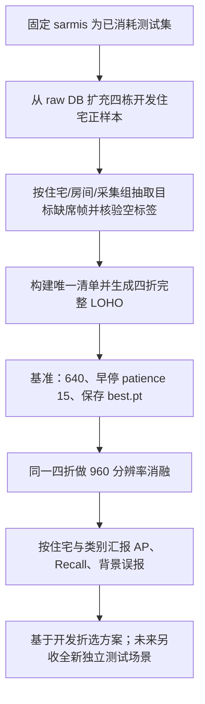

# Robot@Home2 v2 数据、训练与评估流程全面审计

| 项目 | 记录 |
|---|---|
| 审计时间 | 2026-09-30 03:32 Asia/Shanghai（UTC+08:00） |
| 审计范围 | Robot@Home2 原始数据库、v2 四折数据、最终开发集、一次性 sarmis 留出报告、训练配置与增强实现 |
| 本轮动作 | 只读核查并形成下一版本方案；没有启动训练、重评 sarmis、修改权重或改写现有数据 |
| 当前模型 | 单目 RGB；类别 bottle / chair / table；sarmis 已被 v2 最终评估使用，不再用于选模或调参 |

## 结论摘要

下一轮应优先扩大并纠正评估数据，而不是先叠加复杂增强。当前 v2 折数据每个 split、每类最多抽 60 张候选帧；原始数据库四个开发住宅中约有 9,625 张至少带一个目标类标签的观测帧，当前合并开发集只有 1,330 张（约 13.8%）。当前开发集和 sarmis 子集都没有全背景图，故模型在完全没有 bottle/chair/table 的场景中的误报率没有被测量。

用户提出的住宅留一验证方向正确，项目已做过四折 LOHO；但当前每折训练端把三栋住宅合计限制为每类 60 张，且验证集也受每类 60 张上限与候选帧分布影响。它能揭示住宅差异，却不是对各开发住宅完整数据的充分检验。

现有证据确认瓶子是主要弱类。四折 bottle AP50 平均约 0.105（各折 0.037–0.232），sarmis 一次性结果 bottle AP50=0.104；整体四折 mAP50 平均 0.232、mAP50–95 平均 0.121。用户提到的约 0.14 更接近 anto 折的整体 mAP50=0.1357，不是瓶子类 AP50。sarmis 整体 R=0.2996，但 P/R 是 Ultralytics PR 曲线上的 F1 最佳点，不能直接当作某个固定置信度下的部署召回率。

## 核查证据

| 检查项 | 结果 | 影响 |
|---|---|---|
| 训练进程 | 核查时没有 Python/conda 训练进程 | 当前没有训练占用 GPU |
| 原始目标候选数量 | 四个开发住宅在数据库中有 bottle 3,329、chair 4,550、table 5,322 个带相应类别标签的候选观测（类别之间会重叠） | 60 张/类/split 的抽样远低于可用候选量 |
| 带任一目标标签的开发帧 | alma 1,768；anto 3,180；pare 3,223；rx2 1,454；合计 9,625 | 现有 1,330 张开发集只覆盖候选正样本中的一部分 |
| v2 每折采样 | 每类每 split 请求 60 张；例如 alma bottle 候选 739 张、train 三住宅 bottle 候选 2,590 张，仍只各选 60 张 | 类别和场景覆盖受到人为上限约束；train 端的 60 张还分布在三栋住宅之间 |
| 已导出开发集 | 1,330 张唯一图像，宽×高为 240×320；bottle 1,143 框、chair 1,044 框、table 807 框 | 图像数不等于数据库完整开发量 |
| 类别场景覆盖 | 当前留出验证每折的住宅房间覆盖有限；例如 alma bottle 仅 2/3 房间，chair/table 各 1/3；rx2 chair 仅 1/3 | 单一住宅分数可能受具体房间和采样组成影响 |
| 背景负样本 | v2 训练与 sarmis test 都是 0 张全背景图 | 无法评估没有三类目标时的误报率；只用这些样本的 precision 不能覆盖空场景 |
| 可用负样本线索 | 数据库中四个开发住宅分别约有 3,088 / 5,640 / 7,017 / 2,282 张没有三类目标标签且有 RGB/标签文件映射的候选（合计 18,027）；已抽查每住宅一条的 RGB 与 mask 文件存在 | 可从现有资源按住宅/房间/采集组抽取；生成空 YOLO 标签前应确认源语义标注完整并校验文件 |
| 图像/标签完整性 | 对现有 1,330 张开发图像解码、标签格式、类别范围和归一化框范围复核，未发现异常；先前 box audit 也将导出框与源 mask 重算核对 | 当前已导出 v2 数据没有发现需要紧急重标或修补的普遍性错误 |
| 跨折重复 | 1,426 个折内出现记录合并为 1,330 张唯一 observation，重复图像/标签哈希一致 | 去重逻辑正常；各折样本集合仍需统一后再做更充分 LOHO |
| 早停记录 | 四折实际 epoch 数为 50、38、18、44；配置 patience=12；best checkpoint 按 Ultralytics fitness（当前检测任务使用 mAP50–95）保存 | 早停已经存在；不是固定跑满 50 轮。固定 29 轮的最终重训没有有效独立 val，不能用于判断过拟合 |
| 高训练分数 | 最终重训 P/R=.943/.860、mAP50=.920、mAP50–95=.691 来自训练样本内统计 | 它与留出结果不是同口径；足以说明模型对训练样本拟合很强，但不能单独证明泛化失败完全由轮数造成 |
| 最终重训 checkpoint | 全量重训设 `val=False`，因此每轮没有验证 mAP 供 checkpoint 选择；29 轮来自四折最佳 epoch 中位数。最终 train 内评估只作拟合诊断 | `best.pt` 不能解读为验证集最优权重；下一版最终重训报告应明确按 CV 预定轮数训练，并把训练内统计与 CV 验证选择分开 |
| Copy-Paste | 当前数据是 YOLO 检测框标签，没有 segmentation polygons；已安装 Ultralytics 8.4.164 的 CopyPaste 在无 segments 时直接返回原标签 | 直接设置 `copy_paste>0` 对当前数据不生效，不能把它作为当前修复 |
| 切片 | 原图仅 240×320（宽×高）；按 640 letterbox 尺度估算，瓶子框短边中位数约 32 px、P10 约 14 px，155/1,143 个瓶子框短边低于 16 px | 小瓶子确实值得做分辨率消融；对当前低分辨率原图切片会减少上下文且不会创造新细节，暂不优先做 tiled training/inference |
| 现有实现 | 训练脚本支持按住宅隔离、验证、早停和 best.pt；数据转换从源 instance mask 生成框 | 本轮未发现会污染现有标签或使四折住宅泄漏的重大运行时代码 bug；主要问题在样本策略和评估覆盖 |

## 对三项建议的判断

### 1. Leave-one-house-out

保留并加强。四折的验证住宅仍是 alma、anto、pare、rx2；每一轮验证住宅的全部入选样本只进入 val，另外三栋进入 train。新的 split 应由一个固定的去重样本清单生成，确保四折样本规则完全一致，并尽可能使用各开发住宅更多的正样本及适量负样本。汇总应报告四折平均值、范围、每类 AP/Recall、每住宅结果和背景图误报数。

测试住宅 sarmis 已用于 v2 最终评估，不可再次用于选择新数据策略、分辨率、增强或阈值。LOHO 只能作为开发阶段比较；新版本最终测试需要新的独立住宅/场景。

### 2. 提高分辨率与切片

先做固定数据和训练参数下的 640 vs 960 分辨率消融，观察瓶子 AP、Recall、定位质量、显存和速度；若显存允许再评估 1280。每种配置都跑相同四个住宅折，不能只比较单折。640 到 960 会把输入上的物体尺度放大 1.5 倍，但不会增加原始传感器细节。

当前 Robot@Home2 图像宽×高为 240×320，不建议先切成小 tile：切片会进一步缩窄场景上下文，并可能让物体跨 tile 边界。SAHI 类切片更适合未来较高分辨率相机画面；拿到高分辨率素材后再单独比较整图与重叠切片。

### 3. Copy-Paste 与外部 bottle 数据

当前 YOLO 标签只有轴对齐框，标准 Ultralytics Copy-Paste 需要实例分割 mask/polygon；本项目配置该增强不会生效。更合适的顺序是先提高 Robot@Home2 的全住宅覆盖，再看瓶子错误是否仍主要由尺寸/遮挡导致。若需要 Copy-Paste，可利用原数据已有实例 mask 实现 mask-aware 粘贴，或单独建立分割格式实验；粘贴后需处理遮挡、框更新和物理合理性。

外部 bottle 数据先不混入主实验。外部数据的相机、背景、瓶型和标注口径可能形成额外域差异；若它只标 bottle，未标出的 chair/table 会成为错误的背景监督。后续若确实需要，需先核查许可证、去重、类别定义，并确保每张混合图对三类目标的标注完整，之后以独立消融比较。

## 下一轮建议执行顺序

训练控制建议：设较高的最大 epoch 上限（例如 100），patience=15，使用每折验证自动早停并保留 best.pt。checkpoint 的默认主选择继续用 mAP50–95，以免只优化宽松 IoU 的 AP50；同时逐折记录瓶子 AP50/AP50–95、置信度阈值下的 Recall/Precision 曲线和背景误报。面向高召回的运行阈值必须从开发折确定，并同时报告由此带来的误报，不用 sarmis 回调。

| 阶段 | 输入 | 结果/准入条件 |
|---|---|---|
| 数据 v3 | 四住宅目标正样本 + 分层目标缺席帧 | 固定 manifest、按 house 切分、帧/标签可解码、标签类别/坐标通过审计；sarmis 不在清单中 |
| 基准 LOHO | 同一 v3 manifest，640 | 保存每折 best.pt 和完整验证指标；负样本误报有统计 |
| 分辨率消融 | 同一 v3 manifest，960（可选 1280） | 只比较相同四折；瓶子召回改善且背景误报、定位、算力开销可接受 |
| 增强/外部数据 | 只在基准结果定位明确问题后 | 每次只引入一种变化；许可证、类标注完整性和分组边界核验通过 |
| 新版最终测试 | 全新、独立的住宅或采集场景 | 一次性测试，不参与调参；报告与开发评估分开 |

## 已执行与未执行

- 已完成：只读检查数据库候选规模、四折/最终 manifest、图像尺寸与 1,143 个瓶子框尺度、训练 epoch/早停记录、Ultralytics Copy-Paste 条件、既有 box audit 与一次性测试报告。
- 已完成：将数据协议缺陷、严重度、备选修法和首选修法记入作者本地工作日志；内部阶段日志不随公开仓库发布。当前项目阶段与待办见 [项目状态](../docs/PROJECT_STATUS.md)。
- 未执行：未开始新训练；未改写当前 v2 权重、manifest、模型参数或 sarmis 评估产物；未调用 sarmis 重新评估。
- 源码状态：本次未发现需立即改动的重大运行时代码错误，因此没有为“看起来有改动”而改训练脚本；下一次数据 v3 应新增版本化导出器和对应审计，而不是覆盖 v2。

## 技术资料

- Ultralytics 数据增强说明（Copy-Paste 的任务/标签格式限制）：<https://docs.ultralytics.com/guides/yolo-data-augmentation/>
- Simple Copy-Paste 论文，CVPR 2021：<https://openaccess.thecvf.com/content/CVPR2021/html/Ghiasi_Simple_Copy-Paste_Is_a_Strong_Data_Augmentation_Method_for_Instance_CVPR_2021_paper.html>
- SAHI 切片辅助检测论文：<https://arxiv.org/abs/2202.06934>

---

本报告是数据和实验设计审计，不是模型安全认证或真实机器人部署结论。
